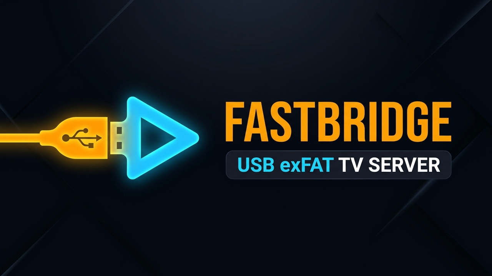
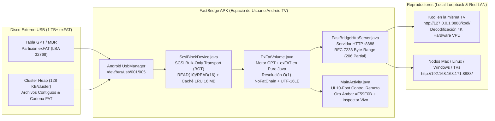
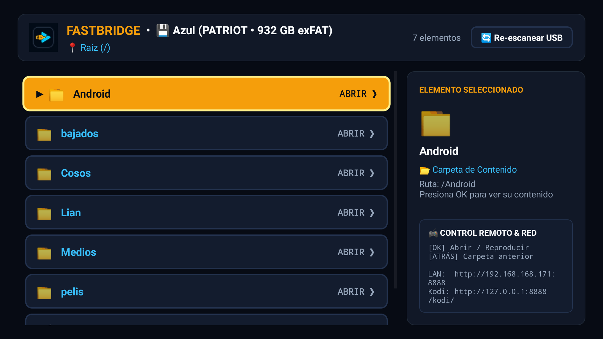

# ⚡ FastBridge — Userspace USB SCSI + exFAT Media Server for Android TV

<p align="center">
  
</p>

<p align="center">
  <b>Read and stream 1 TB+ exFAT USB drives natively on unrooted Android TVs where the manufacturer kernel/vold lacks exFAT support.</b><br/>
  <i>Zero Root • Zero External Dependencies • 100% Read-Only Safe Hot-Unplug • 4K Hardware Direct Play via Kodi & HTTP Byte-Range</i>
</p>

---

## 🧠 1. Contexto y Motivación del Desarrollo

En entornos domésticos y de producción híbridos donde conviven equipos **macOS** (Apple Silicon e Intel), **Linux** (`Pop!_OS` / Debian / Ubuntu) y **Windows**, **`exFAT` es el único sistema de archivos nativo de lectura y escritura sin el límite de 4 GB por archivo** soportado de fábrica por los tres sistemas operativos de escritorio:
* **FAT32 (`vfat`):** Incompatible con películas o archivos mayores a `4 GB`.
* **NTFS:** Solo lectura nativa en macOS sin drivers de terceros.
* **APFS / HFS+ / ext4:** Incompatibles de forma nativa entre macOS y Windows.

### El Problema en Smart TVs con Android TV (Caso Real: TCL `BeyondTV` / Realtek `RTD2851`)
Al conectar un disco externo de `1 TB` formateado en **`exFAT`** (`PATRIOT` — etiqueta `Azul`, partición GPT `sda2`) al puerto USB de una Smart TV TCL (`BeyondTV`, Android TV 9, SoC Realtek `RTD2851`), el sistema operativo detecta el bloque físico (`/dev/block/sda2`), pero **se niega a montarlo (`state=UNMOUNTABLE`)**.

La auditoría empírica por ADB sobre `dumpsys mount`, `/proc/filesystems` y `logcat -s vold` reveló la causa raíz exacta:

```text
V vold: /dev/block/vold/public:8,2: LABEL="QXp1bA==" UUID="656D-445A" TYPE="exfat"
E vold: public:8,2 unsupported filesystem exfat
```

El kernel de fábrica de la TV incluye soporte para `vfat`, `ext4` y `ntfs` (`ufsd`), pero el demonio de sistema `vold` rechaza `exFAT` por carecer del módulo/licencia habilitada en firmware. Además, al ser un firmware de producción (`ro.build.type=user`, sin `root`), ninguna aplicación convencional puede hacer `mount` ni leer `/dev/block/sda2` directamente.

---

## 🛠️ 2. Diseño de Arquitectura e Implementación

Para resolver este bloqueo sin reformatear el disco ni requerir `root` en la TV, se diseñó **FastBridge**: un micro-servidor y explorador nativo para Android TV (`270 KB` con recursos gráficos incluidos, `0` librerías externas) que opera 100% en espacio de usuario.



### Capa 1: Transporte SCSI Bulk-Only (`ScsiBlockDevice.java`)
* Aunque `/dev/block/sda2` pertenezca a `root`, el nodo del bus USB (`/dev/bus/usb/001/005`) pertenece al grupo `usb` y es accesible mediante la API oficial `android.hardware.usb.UsbManager`.
* `FastBridge` reclama la interfaz USB Mass Storage (`Class 0x08`, `Subclass 0x06`, `Protocol 0x50`) con `claimInterface(intf, true)`, desacoplando limpiamente el driver inactivo del kernel y tomando control exclusivo de los endpoints `Bulk-IN` y `Bulk-OUT`.
* Implementa el protocolo **USB Mass Storage Bulk-Only Transport (BOT)** empaquetando estructuras **CBW** (`Command Block Wrapper`, firma `0x43425355` `"USBC"`) y validando **CSW** (`Command Status Wrapper`, firma `0x53425355` `"USBS"`):
  * `INQUIRY (0x12)`: Identifica fabricante y modelo del disco (`PATRIOT`).
  * `TEST UNIT READY (0x00)` + `REQUEST SENSE (0x03)`: Limpia estados de *Unit Attention*.
  * `READ CAPACITY(10) (0x25)` y `READ CAPACITY(16) (0x9E/0x10)`: Obtiene el tamaño de sector (`512 B`) y capacidad total (`1,953,525,168` sectores = `1 TB`), soportando discos mayores a `2 TB` (LBA de 64 bits).
  * `READ(10) (0x28)` y `READ(16) (0x88)`: Lee ráfagas de `128` sectores (`64 KB`) por transacción USB.
* **Caché LRU en RAM Acotada:** Mantiene hasta `256` chunks de `64 KB` (`16 MB` máximo en RAM), acelerando la navegación de directorios y las lecturas secuenciales sin desbordar la memoria de la TV.

### Capa 2: Motor GPT + `exFAT` en Espacio de Usuario (`ExFatVolume.java`)
* **Descubrimiento de Particiones:** Analiza el Sector 0 (VBR directo o tabla MBR) y el Sector 1 (`EFI PART` — Tabla de Particiones GPT), localizando automáticamente cualquier partición con firma `EXFAT   ` (en el caso del disco `Azul`, la partición GPT #2 en `LBA 32768`).
* **Lectura Directa `O(1)` (`NoFatChain`):** En `exFAT`, los archivos grandes copiados secuencialmente activan el bit `NoFatChain` (`0x02` en la entrada `0xC0` *Stream Extension*). Para estos archivos, `FastBridge` no necesita recorrer la tabla FAT: calcula el desplazamiento físico en disco mediante una sola operación aritmética entera y sirve cualquier salto de tiempo (`Seek`) de inmediato. Para archivos fragmentados, recorre y memoriza la cadena de clústeres desde la tabla FAT.
* **Decodificación de Directorios y Limpieza macOS:** Ensambla conjuntos de entradas de 32 bytes (`0x83` Etiqueta de Volumen, `0x85` Atributos de Archivo, `0xC0` Extensión de Flujo y múltiples `0xC1` para nombres largos en `UTF-16LE`), filtrando automáticamente archivos basura de macOS (`._*`, `.DS_Store`, `.Spotlight-V100`, `.Trashes`, `.TemporaryItems`).

### Capa 3: Seguridad Total ante Desconexión en Caliente (`100% Read-Only`)
* `FastBridge` **no contiene ni una sola instrucción `WRITE` SCSI**. Nunca modifica el sector de arranque, nunca activa el bit `VolumeDirty` (`offset 106` de `exFAT`) y nunca escribe en la FAT.
* Puedes desconectar el disco USB de la TV en caliente en cualquier momento (incluso a mitad de una reproducción) con **cero riesgo de corrupción** y sin que macOS bloquee el montaje siguiente con `fsck_exfat`.
* Además, `BridgeService` escucha `ACTION_USB_DEVICE_DETACHED` y `ACTION_USB_DEVICE_ATTACHED` en tiempo real para liberar o re-montar el disco automáticamente al desconectarlo y volverlo a enchufar.

### Capa 4: Servidor HTTP Multihilo + Streaming 4K en Hardware (`FastBridgeHttpServer.java`)
* Ejecutado dentro de un `ForegroundService` persistente (`BridgeService.java`) en el puerto `8888`:
  * **Streaming con `RFC 7233 Byte-Range (HTTP 206 Partial Content)`:** Permite adelantar o atrasar archivos `.mkv` y `.mp4` de múltiples gigabytes de forma instantánea.
  * **Decodificación 4K / HEVC / Dolby Vision / AC-3 / DTS sin Transcodificación:** Al exponer el índice `/kodi/` en `http://127.0.0.1:8888/kodi/` dentro de la misma TV (interfaz *loopback*, sin pasar por Wi-Fi), **Kodi** y el reproductor nativo de Android TV demultiplexan contenedores `.mkv` 4K directamente usando los decodificadores en silicio del chip **Realtek `RTD2851`** (`OMX.realtek.video.decoder` y `OMX.RTK.audio.decoder`).

---

## 📺 3. Interfaz Android TV (10-Foot UI para Control Remoto)

<p align="center">
  
</p>

Diseñada específicamente para verse a 3 metros de distancia y operarse con las flechas (`D-Pad`) del control remoto de la TV:
* **Foco de Alto Contraste:** Fondo Negro Obsidiana (`#070B14`) con tarjetas en Azul Pizarra (`#131C2E`) que al seleccionarse se iluminan por completo en **Oro Ámbar brillante (`#F59E0B`)** con borde `#FEF08A`, texto oscuro en negrita (`#090D16`), indicador `▶` y ligero zoom (`1.03x`).
* **Inspector en Tiempo Real (Columna Derecha):** Muestra al instante el ícono en grande, nombre completo sin truncar, formato, tamaño en GB/MB, modo de asignación (`Contiguo O(1)` vs `Cadena FAT`) y atajos del control remoto.
* **Memoria de Foco por Carpeta:** Al pulsar `ATRÁS` (`BACK`) en el control remoto para subir al directorio padre, el cursor recuerda automáticamente de qué subcarpeta saliste y vuelve a enfocarla.

---

## 📊 4. Consumo Empírico de Recursos en Smart TV TCL (`BeyondTV`)

Medición real tomada mediante `adb shell dumpsys meminfo com.fastmovie.fastbridge` y `top` en Android TV 9 (`2 GB` RAM, ARMv7):

| Métrica | Valor Medido | Detalle Técnico |
| :--- | :--- | :--- |
| **Tamaño del APK** | **`270 KB`** (`37 KB` sin imágenes) | 100% SDK estándar de Android (`0` librerías externas) |
| **CPU en Reposo** | **`0.0%`** | Hilos bloqueados en `ServerSocket.accept()` sin polling |
| **CPU en Streaming** | **`2% - 4%`** | Copia directa de chunks SCSI de `64 KB` a socket loopback/LAN |
| **Memoria RAM Total (PSS)** | **`36.5 MB`** (`1.8%` de la TV) | Incluye la caché LRU acotada de bloques USB en el Java Heap |
| **Memoria Gráfica / GPU** | **`0 KB`** | Vistas nativas con `GradientDrawable` sin WebViews pesados |

---

## 🚀 5. Endpoints del Servidor (`Puerto 8888`)

| Ruta | Descripción | Uso Principal |
| :--- | :--- | :--- |
| `http://<TV_IP>:8888/` | Interfaz Web Oscura interactiva | Navegadores en Mac, PC, móviles o tablets |
| `http://127.0.0.1:8888/kodi/` | Índice HTML estilo Apache | Fuente local de Videos/Archivos en **Kodi** dentro de la TV |
| `http://<TV_IP>:8888/kodi/` | Índice HTML en red local | Fuente remota para **Kodi** en otras TVs de la casa |
| `http://<TV_IP>:8888/stream/<ruta>` | Streaming directo con `HTTP 206 Range` | Reproducción directa en VLC, Kodi, MPV o HTML5 `<video>` |
| `http://<TV_IP>:8888/api/status` | Estado JSON del disco USB y partición `exFAT` | Monitoreo y automatización |
| `http://<TV_IP>:8888/api/list?path=/...` | Inventario JSON de cualquier carpeta | Integración con catálogos como **FastMovie** |

---

## 🔧 6. Compilación e Instalación por ADB

El proyecto compila directamente con `javac`, `aapt2`, `d8`, `zipalign` y `apksigner` en menos de 3 segundos sin requerir Gradle ni Android Studio:

```bash
# 1. Compilar y firmar FastBridge.apk
./build.sh

# 2. Instalar en la Smart TV por red (ADB)
adb connect 192.168.168.171:5555
adb -s 192.168.168.171:5555 install -r FastBridge.apk

# 3. Iniciar FastBridge en la TV
adb -s 192.168.168.171:5555 shell am start -n com.fastmovie.fastbridge/.MainActivity
```

---

## 📁 Estructura del Repositorio

```text
fastbridge/
├── AndroidManifest.xml              # Declaración Leanback TV, servicio Foreground y filtro USB BOT
├── build.sh                         # Script de compilación rápida (aapt2 + javac + d8 + apksigner)
├── FastBridge.apk                   # APK compilado y firmado listo para instalar por ADB
├── assets/
│   ├── banner.png                   # Banner oficial 16:9
│   ├── icon.png                     # Logotipo oficial 1:1
│   └── tv_screenshot.png            # Captura real en Smart TV TCL BeyondTV
├── res/
│   ├── drawable/                    # Banner Leanback e ícono de cabecera
│   ├── mipmap-*/                    # Íconos de lanzador en todas las densidades (mdpi a xxxhdpi)
│   └── xml/usb_device_filter.xml    # Filtro USB Mass Storage (Class 8, Subclass 6, Protocol 80)
└── src/com/fastmovie/fastbridge/
    ├── ScsiBlockDevice.java         # Driver USB Host SCSI Bulk-Only Transport + Caché LRU
    ├── ExFatVolume.java             # Parser de particiones GPT/MBR y sistema de archivos exFAT
    ├── FastBridgeHttpServer.java    # Servidor HTTP multihilo (Byte-Range 206, Kodi Index, JSON API)
    ├── BridgeService.java           # Servicio persistente Android TV + Hot-Plug / Hot-Unplug
    └── MainActivity.java            # Interfaz Android TV 10-Foot con foco Oro Ámbar e Inspector
```
